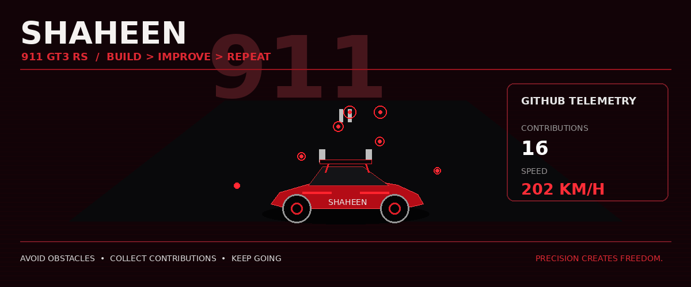

<!-- OPTIONAL: drag your intro video here in the GitHub editor and it turns into a playable link -->

 

---

<h2 align="center">Who am I</h2>

Hi, I'm **Shaheen**, an Artificial Intelligence student from Cairo, Egypt. I like building clean, practical projects that feel finished, not just functional. I work with C# and object-oriented design, and I'm learning more about programming and AI with every project.

---

<h2 align="center">A bit more about me</h2>

- [x] Studying Artificial Intelligence
- [x] Building projects in C# (OOP, a hotel management system)
- [x] Learning every day and improving each project
- [ ] Looking for a bigger project to take on
- [x] Happy to help if you have a question

---

<h2 align="center">GitHub stats</h2>

---

<h2 align="center">My stack</h2>

 

`C#` · `Python` · `HTML` · `CSS` · `JavaScript` · `Assembly` · `C++`

---

<h2 align="center">Featured repositories</h2>

